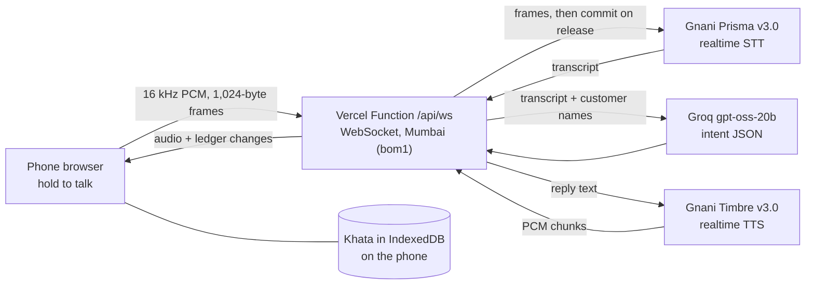

# Voice Khata

A khata (credit ledger) a kirana shopkeeper talks to across the counter. Hold one button, say
"Ramesh ka 340 udhaar, kal 200 diya tha", let go, and the phone answers in your language (median first audio
0.8 to 1.1 s across our Hindi, English and Kannada runs; not yet measured with a timer on a phone) and updates the khata. No typing. Built for BolBharat (Gnani x HackBriven), track PS2.

**Live:** https://voice-khata-gray.vercel.app (built for Chrome on a low-end Android phone; on a laptop, hold the
space bar)

## What it does

| You say | It does |
|---|---|
| रमेश का तीन सौ चालीस उधार लिखो | two customers are called Ramesh, so it asks: "कौन से Ramesh? Ramesh Sharma या Ramesh Doodhwala?" |
| शर्मा जी वाले | adds ₹340 udhaar to Ramesh Sharma and reads it back with his new balance |
| नहीं, चार सौ तीस | fixes the entry it just wrote to ₹430 |
| Ramesh Sharma का total कितना है? | says his balance |
| आज कितना उधार गया? | says today's total credit and the number of entries |
| अनिल का पाँच सौ उधार, कल दो सौ दिया था | two entries: ₹500 udhaar today, ₹200 jama dated yesterday |
| ರಮೇಶ್ ಶರ್ಮಾ ಅವರಿಗೆ ಮುನ್ನೂರ ನಲವತ್ತು ರೂಪಾಯಿ ಸಾಲ ಬರೆಯಿರಿ | same flow in Kannada; English works too. The other seven Timbre languages have reply text but have not been run end to end |

Say why, and it keeps a short note with the entry: "Mohan ka 800 udhaar, cheeni aur chawal ka" stores the note
"cheeni aur chawal ka" next to the ₹800.

When you pick a language it greets you and says it is an AI, in that language. If that greeting is cut off or
never plays, the next reply starts with the AI line instead; it counts as said only once a reply carrying it plays
to the end. Switching language owes the disclosure again.

## Two books, one chat

The screen is a chat: speak (hold the mic) or type, and each turn shows what was heard, the reply, and cards for the
entries it wrote.

- **दुकान खाता** (default, BolBharat PS2): customer udhaar and jama, as above.
- **घर का खर्चा**: household spending for whoever runs the house. "chai 20, auto 50, sabzi 120" adds three expenses with
  categories; "Rahul ke saath dinner 1200, aadha mera" adds a split (your share ₹600, Rahul owes ₹600);
  "aaj kitna kharcha hua", "is mahine khane pe kitna" answer from the same records.

## 24 Indian languages

| Tier | Languages | How |
|---|---|---|
| Native (Gnani) | Hindi, Bengali, Marathi, Tamil, Telugu, Gujarati, Kannada, Malayalam, Punjabi, plus English | Prisma and Timbre directly |
| Beta | Odia, Urdu, Bhojpuri, Maithili, Konkani, Kashmiri, Santali, Tulu, Nepali, Sindhi, Assamese | heard and spoken through a close Gnani language (Odia and Assamese through Bengali, Tulu through Kannada, Konkani through Marathi, the rest through Hindi); replies are written in the user's own language and, for Odia, re-lettered into Bengali script only for the voice |
| Experimental | Dogri, Manipuri, Sanskrit, Bodo | same trick, lower clarity |

The beta order comes from a clarity screen in our earlier project (how many words Prisma recovered from the sister
voice). Replies for the 15 non-native languages are machine-translated and have not been checked by native speakers;
the language picker says so.

## How it works



1. While the button is held, an AudioWorklet turns the mic into 16 kHz 16-bit frames of exactly 1,024 bytes
   and streams them to our server, which relays them to Prisma. Prisma's partial transcripts (about every 0.6 s)
   show on screen as you speak, greyed until the final one arrives. Partials are not in Gnani's docs; the stream
   echoes `partials_enabled` in its config and the `x-partials: true` header turns them on
   (`scripts/probe-partials.mjs`). Only the final transcript is acted on.
2. On release the server sends Prisma a `commit` at once instead of waiting for silence, then waits for Prisma's
   final transcript (up to 2.5 s; in the live runs it came in 95 to 425 ms). That is the endpointing.
3. The transcript and the customer list go to an LLM that returns one JSON intent: add entries, correct the
   last one, ask a total, ask today's total, or answer "which Ramesh".
4. Our own code (`api/_lib/ledger.ts`) does every sum and balance. The LLM only extracts the amount it heard;
   when the transcript holds exactly one amount and the turn adds one entry or corrects one, the transcript's
   amount is used if the LLM wrote a different one (`crossCheck` in `api/_lib/session.ts`).
5. The reply streams back from Timbre in chunks and plays as it arrives. Pressing the button again stops it
   (barge-in) and the server drops the rest of that reply.

## Demo Google Sheet (opt-in, off by default)

A toggle under the khata, "डेमो शीट में भी लिखें (ये शीट सब देख सकते हैं)", also appends each entry to one public demo
Google Sheet. It is off by default, so the khata stays on the phone unless you switch it on. The sheet is append-only:
a correction adds a reversal row and the corrected row, and nothing is ever edited. Four tabs are formulas over the
Entries tab: Receivables (what each customer owes and how old it is), Aging (0-30, 31-60, 60+ days), Top dues
(the few customers holding most of the money, 80/20) and Trends (daily udhaar vs jama, collection rate, chart).

How it is wired: the server posts new rows to a small Apps Script web app (`sheet/hook.gs`) owned by the sheet's
account; its URL stays in a server environment variable. `setup()` in that file builds the whole sheet once. The
toggle only appears after the hook reports the sheet's link.

## Gnani API Platform services used

| Service | How we call it | Settings that matter |
|---|---|---|
| **Prisma v3.0, realtime streaming STT** | `wss://api.vachana.ai/stt/v3/stream` | `model=prisma-v3.0`, one `language_code` per session, `format=transcribe` (the model writes amounts as digits), `keyterms` = the Latin-script customer names known when the session connects (max 200), `topic`, `x-min-silence-ms=2000` because the button release ends each utterance, `x-partials: true` for live words |
| **Timbre v3.0, realtime TTS** | `wss://api.vachana.ai/api/v1/tts` | voice `Shivani`, raw PCM 24 kHz, a fresh socket per reply opened before it is needed, a 5 s first-audio watchdog with one retry; ₹ amounts are left to Timbre's text normalisation |

LLM: Groq `openai/gpt-oss-20b` with JSON output, falling back to `gpt-oss-120b` and then Gemini Flash-Lite. Groq's
free tier allows the 20b model 8,000 tokens a minute (about 9 turns), so a fast run spills to the fallbacks. Orchestration: our own
TypeScript on Vercel Functions WebSockets. No hosted agent platform, no telephony, no voice cloning.

Two things we found that differ from the docs (22 Nov 2026): the streaming endpoint rejects a comma-separated
language list such as `hi-IN,en-IN` (reproduce with `node scripts/probe-headers.mjs`), so each session uses the one language the shopkeeper picked; English words
inside Hindi still come through. And reusing one Timbre socket for several replies once left a reply waiting forever in a live run, so each
reply now gets its own socket, opened ahead of time.

## Measured results

All runs hit the live deployment. All test audio is synthetic: shop lines spoken by Timbre voices, never real customer recordings. "Chatter"
mixes a second voice saying another line underneath at 40% volume. First audio = button release to the first
byte of reply audio reaching the client, measured from a home laptop on Wi-Fi. The on-screen badge adds
the 150 ms the page keeps listening after release.

| Run | Turns correct | First audio p50 | p90 | File |
|---|---|---|---|---|
| Hindi and code-mix (which-Ramesh question, correction, totals, two entries in one sentence) | 9/9 | 904 ms | 1,731 ms | `docs/results/live-e2e-hi-IN-clean.json` |
| Same 9 turns with chatter | 9/9 | 788 ms | 1,112 ms | `docs/results/live-e2e-hi-IN-noise.json` |
| Kannada | 4/4 | 1,098 ms | 1,248 ms | `docs/results/live-e2e-kn-IN-clean.json` |
| English | 5/5 | 913 ms | 934 ms | `docs/results/live-e2e-en-IN-clean.json` |

Barge-in (`scripts/bargein.mjs`, live): a reply interrupted 0.5 s into its audio never finished, the next turn
completed, no errors.

A turn counts as correct when the amount, the credit or payment direction and the customer all match, or the
reply carries the expected names or ₹ total and changes nothing. The committed records came from these runs;
running `scripts/e2e.mjs` yourself writes new ones to `test-audio/` (git-ignored). Speech step alone (`docs/results/spike-stt-tts.json`): with
`format=transcribe` Prisma wrote the amount as exact digits on 9/9 clean lines and 9/9 with chatter (median
release to text 339 ms and 327 ms); with `format=codemix` it wrote amounts as words (0/9 digits), so we use
`transcribe`. Timbre's first audio on a warm socket was 158 to 212 ms.

These are small synthetic runs, not field data. Real shop noise and real voices will do worse.

## Responsible AI and compliance

| Rule | What we do |
|---|---|
| AI disclosure | The greeting says it is an AI in the chosen language; until a turn carrying that line has played to the end, every reply starts with it (`greeting()` in `api/_lib/replies.ts`, `reply()` and `disclosure()` in `api/_lib/session.ts`) |
| Data | The seeded khata is synthetic (`resetDemo()` in `public/store.js`); entries you speak are saved only in that phone's IndexedDB. The server holds the ledger in memory while the socket is open and writes no transcript, ledger or audio to disk or a database. Audio, transcripts and customer names go to Gnani and Groq for processing. Server logs hold timings, the intent kind, the reply key and the model name; error lines can include an upstream error message. Vercel keeps function logs under its own policy. With the demo-sheet toggle on (off by default), entries are also appended to a public demo Google Sheet, and the page says so next to the toggle |
| Money | Records credit and payments only. Replies confirm entries and state balances. No lending, and no reminders are sent to anyone |
| Secrets | Keys live in `.env.local` (git-ignored) and Vercel environment variables. The browser never sees a key: browsers cannot set WebSocket headers, so the server relays |
| Voices | Stock Timbre voice only. No cloning |

## Run it yourself

```bash
git clone https://github.com/Atishyy27/voice-khata && cd voice-khata
npm install
cp .env.example .env.local        # add GNANI_API_KEY and GROQ_API_KEY
npx tsx scripts/dev.ts            # http://localhost:3000
npm test                          # ledger, amount and reply unit tests
node scripts/e2e.mjs [ws-url] [hi-IN|kn-IN|en-IN] [--noise]   # spoken end-to-end turns
```

Deploy: `vercel deploy --prod` with `GNANI_API_KEY` and `GROQ_API_KEY` set in the project. `vercel.json` pins the
Mumbai region and the function's 300 s limit; the page reconnects when a socket closes.

## Files

| Path | What it is |
|---|---|
| `api/ws.ts` | WebSocket entry (Vercel Function) |
| `api/_lib/session.ts` | one conversation: relay audio, turn timing, barge-in, disclosure |
| `api/_lib/stt.ts`, `api/_lib/tts.ts` | Prisma and Timbre socket wrappers |
| `api/_lib/parse.ts` | utterance to intent JSON |
| `api/_lib/ledger.ts`, `api/_lib/numbers.ts`, `api/_lib/replies.ts` | khata maths, amount reading, reply text (written for 10 languages, run in 3) |
| `api/_lib/sheet.ts`, `sheet/hook.gs` | opt-in demo sheet: rows to append (with reversal rows), the Apps Script that appends them and builds the sheet |
| `public/` | the page: `app.js`, `worklet.js` (mic to 16 kHz frames), `player.js` (gapless playback), `store.js` (IndexedDB) |
| `scripts/` | `dev.ts` local server, `spike.mjs` speech test, `e2e.mjs` end-to-end test, `probe-headers.mjs` language-list check |

## Known limits

- Replies exist for all 10 Timbre languages, but none has been checked by a native speaker yet. Hindi, English and
  Kannada were run end to end; server error messages are in Hindi only.
- One language per session (see the docs note above). Change it from the language link on the page.
- Tested on synthetic voices with synthetic chatter, not in a real shop.
